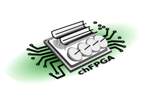

.. chFPGA documentation master file, created by
   sphinx-quickstart on Wed Nov 16 04:00:38 2016.
   You can adapt this file completely to your liking, but it should at least
   contain the root `toctree` directive.

.. title:: chFPGA

.. image:: images/chfpga_text.svg
   :width: 30%

-------------------------------------------------

..  chFPGA: Data acquisition, Channelizer, corner-turn and correlator engine FPGA firmware for the IceBoard FPGAs

chFPGA is a FPGA firmware that is used to implement interferometer radiotelescope front-ends ranging from single board, stand-alone correlators to arrays of hundreds of boards than feed a correlator farm. chFPGA is primarily designed to run on a Xilinx Kintex-7-based IceBoard motherboard, although it has been used in the past on Virtex 6 and Kintex 7 evaluation boards.  In its IceBoard implementation, it interfaces with FMC Mezzanine boards to acquire  16 ADC analog channels at 800 Msps, channelizes the data in 1024 frequency bins (F-engine), and can either implement an on-board 16-channel correlator (X-engine) or reorder and redistribute the data with other boards before sending it to an external correlator.

chFPGA was originally designed for and is currently used in the CHIME (Canadian Hydrogen Intensity Mapping Experiment), which is a 2048-element, 400 MHz bandwidth interferometer. CHIME uses chFPGA as a data acquisition, F-Engine, and corner-turn engine and feeds a 256-node GPU correlator farm.

A block diagram of chFPGA used in this configuration is shown in chfpga_block_diagram_.

.. _chfpga_block_diagram:
.. figure:: images/chFPGA_block_diagram2.svg
   :width: 50%

###########
Quick Links
###########

* Source Code Hierarchy

.. .. include:: history.rst

.. .. include:: requirements.rst

.. .. include:: features.rst

#########
Contents:
#########

.. toctree::
   :maxdepth: 2

   introduction
   architecture
   implementation
   vhdl_domain

.. coding_conventions
.. internal_buses
.. udp_command_protocol
.. modules
.. clocking
.. channelizer
.. crossbar
.. backplane_shuffle
.. about_this_document
.. floorplanning
.. documenting_vhdl_in_sphinx

Indices and tables
------------------

* :ref:`genindex`
* :ref:`search`

